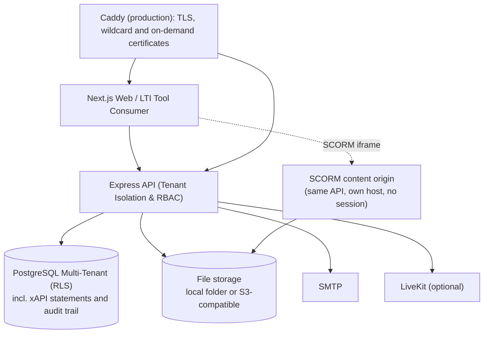

# Enterprise Educational Learning Management System (LMS)

> Multi-tenant LMS for universities and training organisations: courses, quizzes, assignments, gradebook,
> live classes, SCORM 1.2/2004, LTI 1.3 launch, xAPI learning records, SSO/SCIM, and privacy tooling for FERPA and
> GDPR requests.

---

## Architecture Overview



Not built yet (see [docs/ROADMAP.md](docs/ROADMAP.md)): API gateway/WAF, Redis as a cache and job queue (it is only
used for shared rate limits today), a dedicated LRS (xAPI is stored in PostgreSQL today),
mobile apps.
Compliance (FERPA, SOC 2, WCAG) is **not** claimed by the software; `GET /api/v1/admin/compliance` reports measured facts only.

---

## Monorepo Structure

```text
LMS/
├── apps/
│   ├── api/                 # Express backend with tenant, session and security middleware
│   └── web/                 # Next.js Enterprise Student & Instructor Portal
├── packages/
│   ├── database/            # Multi-Tenant Prisma Schema & PostgreSQL RLS Policies
│   └── security/            # AES-256-GCM Field-Level Encryption & RBAC/ABAC engine
├── deploy/                  # Production images (API, web, Caddy), the Caddyfile, database init script
├── docs/
│   ├── architecture/        # In-depth architectural, compliance, and multi-tenancy guides
│   ├── deployment/          # DNS, certificates and first deploy (dns-and-tls.md)
│   ├── custom-domains.md    # How an organisation uses its own domain
│   └── ROADMAP.md           # Status of every planned item
├── .github/workflows/       # CI: type checks, lint, tests
├── docker-compose.yml       # Local services (PostgreSQL, optional ClamAV)
├── docker-compose.prod.yml  # The production stack (see "Deployment")
├── .env.example             # Every setting, development defaults
├── .env.production.example  # The settings a production deployment needs
├── package.json             # Monorepo Workspace Configuration
└── tsconfig.json            # Root TypeScript Paths & Config
```

---

## What it does

1. **Multi-tenancy and white-labelling**
   - Every organisation has an address of its own, `<slug>.<TENANT_BASE_DOMAIN>`, and can add a custom domain
     (`learn.university.edu`) once it has proved control of the domain's DNS ([docs/custom-domains.md](docs/custom-domains.md)).
   - Isolation is enforced in the database by PostgreSQL row-level security, as well as in queries.
   - Organisations join by **registration with operator approval**, and the **platform operator** runs them from a
     console (see "Running the platform").
2. **Teaching and learning**
   - Courses, modules and lessons, grouped by academic **terms**; a course can be **copied** into a new term with its
     material (lessons, quizzes, assignments, rubrics, grade setup, question bank) and its dates moved.
   - Optional **publishing review**: an organisation can require an administrator to approve courses before they go live.
   - Quizzes with timing, availability windows, attempts, auto-grading, manual grading and attempt review; assignments
     with rubrics, late-work rules, per-learner extensions, **submission history**, grade appeals and
     plagiarism checks (a **Copyleaks** adapter, or any provider that calls back).
   - **Administrators oversee courses, teachers run them**: the admin area lists courses, assigns teachers and
     approves final grades; it has no teaching tools.
   - A weighted gradebook with a curve, two-person grade approval, a **grade grid** of every learner and item, and
     **CSV export**. Courses **complete automatically** when every lesson is done and, for graded courses, the
     approved grade passes.
   - **File uploads** (assignment files, lesson videos and documents) to a local folder or any S3-compatible service,
     **scanned for viruses** with ClamAV before they are stored.
   - A **course home** for learners (syllabus, upcoming work, "Continue: next lesson"), announcements, live classes on
     LiveKit, forums with moderation, a calendar that shows quiz and assignment due dates (with iCal export),
     notifications by e-mail.
3. **Interoperability**
   - **SCORM 1.2 and 2004**: packages are uploaded, unpacked and played on a separate content origin; progress and
     scores are saved, and completion finishes the lesson.
   - **LTI 1.3** resource-link launch (signature-verified). Assignment and Grade Services, Names and Roles and Deep
     Linking are not implemented yet.
   - **xAPI** statements are stored and queryable in PostgreSQL.
   - **SCIM 2.0** user provisioning, **OIDC** and **SAML 2.0** single sign-on. An organisation can let accounts be
     **created at first SSO sign-in** (off by default; only for its allowed e-mail domains, learner role, seat quota applies).
4. **Security and privacy**
   - Append-only audit trail enforced by the database, MFA (TOTP), server-side session revocation.
   - Self-serve personal-data export, directory opt-out and erasure for FERPA and GDPR requests.
   - Quiz proctoring records browser events (tab switches, leaving full screen, copy and paste) and, per quiz, what
     the **camera and microphone** pick up (face out of view, more than one face, sustained sound, a device turned
     off). Detection runs in the learner's browser (MediaPipe face detector, served by the web app): only events
     are sent, never images or sound. It does not decide anything on its own: staff review the events.
5. **AI assistance (optional)**
   - A study tutor for learners, grounded in the course's lessons, and draft course outlines for instructors.
   - Each organisation's administrators choose the provider (Claude, Gemini or Grok), the model and the API key under
     Administration › Plan & Integrations; the key is stored encrypted and never shown again. A platform-wide default
     can be set with `AI_PROVIDER` / `AI_API_KEY`. Without a key the AI features are hidden.
6. **Operating organisations** (see "Running the platform")
   - **Consented support access**: an administrator lets the platform operator in for a limited time, read-only by default.
   - **Offboarding**: a full export of an organisation's data, and scheduled deletion with a grace period.
   - **Trials** (off by default) with reminders, a read-only period and then suspension.

---

## Getting Started

### 1. Install dependencies
```bash
npm install
```

### 2. Configure environment
```bash
cp .env.example .env
```
Replace every `CHANGE_ME` value. The API **refuses to start** with missing, short, placeholder, or publicly known secrets.

```bash
node -e "console.log('JWT_SECRET=' + require('crypto').randomBytes(48).toString('base64url'))"
node -e "console.log('PII_ENCRYPTION_KEY=' + require('crypto').randomBytes(32).toString('hex'))"
```

### 3. Database
Needs PostgreSQL. Use two roles: an unprivileged `lms_app` for the API and a privileged one for migrations (see [multi-tenancy](docs/architecture/multi_tenancy.md#3-database-roles-important)).
```bash
psql -f packages/database/sql/create_app_role.sql        # once, as a superuser
npm run db:deploy -w @enterprise-lms/database           # migrations (uses DIRECT_URL)
npm run db:seed   -w @enterprise-lms/database           # dev only; users get SEED_PASSWORD
```
The `db:*` scripts load the root `.env` for you.

### 4. Run
```bash
npm run dev   # API on :4000, web on :3000
```

### 5. Test
```bash
npm test                                  # API, database, security and web packages (the API tests start their own PostgreSQL)
npm run lint                              # no errors allowed
npm run typecheck                         # root TypeScript check
(cd apps/web && npx tsc --noEmit -p .)    # the root typecheck does not cover the web app
```
CI (`.github/workflows/ci.yml`) runs the same checks on every push. After changing routes or response shapes, run
`npm run api:sync` (see "API description").

### 6. Create the platform operator (once)
Organisations are registered, approved and managed by a **platform operator**: a super administrator of a special
operator organisation. Set `PLATFORM_OPERATOR_TENANT` (its address, e.g. `platform`) in `.env`, then:
```bash
npm run platform:bootstrap -w @enterprise-lms/api -- --email you@example.com --first Ada --last Lovelace
```
It creates the operator organisation and invites you (with `--password` it sets one directly). Sign in at that
organisation's address and open `/platform`.

### File storage and SCORM

| Setting | What it does |
|---|---|
| `STORAGE_DRIVER=local` (default), `STORAGE_LOCAL_DIR` | Uploads go to a folder on the API server (one server only; back it up). docker-compose keeps it in the `uploads` volume. |
| `STORAGE_DRIVER=s3`, `S3_BUCKET`, `S3_REGION`, `S3_ENDPOINT`, `S3_ACCESS_KEY_ID`, `S3_SECRET_ACCESS_KEY`, `S3_FORCE_PATH_STYLE` | Any S3-compatible service (AWS S3, Cloudflare R2, MinIO, Backblaze B2). Downloads redirect to five-minute signed links. |
| `UPLOAD_MAX_MB` (default 100) | Largest upload. The web proxy limit in `apps/web/next.config.ts` must be at least this. |
| `CLAMAV_URL` (e.g. `tcp://clamav:3310`), `CLAMAV_TIMEOUT_MS`, `FILE_SCAN_SWEEP_INTERVAL_SECONDS` | Scan every upload with a ClamAV daemon before it is stored. Infected files are refused (422, audited); while the scanner cannot answer, uploads are refused (503). Files stored before it was set are scanned in the background, and any found infected are no longer served (410). Unset: uploads are stored unscanned, with a warning at startup in production. docker-compose: `CLAMAV_URL=tcp://clamav:3310 docker compose --profile scan up`. |
| `SCORM_CONTENT_ORIGIN` | Where SCORM packages are served: a host name of its own pointing at the API (e.g. `https://content.example.org`), never the web app's origin, and not sharing a cookie domain with it. Without it SCORM is off in production; development uses `http://127.0.0.1:4000`. |

Uploads are refused when their type could run script in a browser (HTML, SVG) and are always served with `nosniff`.
SCORM packages run their own scripts, which is why they live on their own origin: there is no session there, every
link carries a signed token for one learner and one package, the host answers nothing but `/scorm-content`, and only
the LMS may frame it.

---

## Running the platform

Everything here is for the **platform operator** (`/platform`) and for organisation administrators (`/admin`).

### Organisations, addresses and registration

| Setting | What it does |
|---|---|
| `TENANT_BASE_DOMAIN` (e.g. `lms.example.com`; `localhost:3000` in development) | Every organisation is served at `<slug>.<TENANT_BASE_DOMAIN>`. Names the platform itself uses (the web app, API, SCORM host, the operator's address, the custom-domain target) are reserved. |
| `PLATFORM_OPERATOR_TENANT` | The operator organisation. Its super administrators approve registrations, create and suspend organisations, and set plans, seats and feature overrides. |
| `ORG_REGISTRATION_ENABLED`, `ORG_REQUEST_RATE_LIMIT_MAX` | The public registration form (`/register`): address availability, institution details, e-mail confirmation of the contact, then operator approval. `false` closes the form. |
| `TURNSTILE_SITE_KEY`, `TURNSTILE_SECRET_KEY` | Cloudflare Turnstile CAPTCHA on the public forms. Set both or neither; once set, a failed or unreachable check refuses the form. |
| `TRUST_PROXY` | How many proxies stand in front of the API (1 behind Caddy or the Next.js proxy). The tenant is read from the host the proxy reports. |

- **Find my organisation** (`/find-organisation`): a person enters their e-mail address and is sent, to that address
  only, the addresses of the organisations they belong to. The answer on screen is always the same.
- **Custom domains** are verified with a DNS TXT record before they work, and re-checked daily; a record that goes
  missing starts a grace period (`CUSTOM_DOMAIN_RECHECK_INTERVAL_SECONDS`, `CUSTOM_DOMAIN_RECHECK_GRACE_DAYS`) and the
  administrators are warned before the domain is removed. See [docs/custom-domains.md](docs/custom-domains.md).
- **Suspending** an organisation ends every session in it at once, and blocks sign-in and SCIM until it is reactivated.

### Support access

Platform staff can only enter an organisation with its administrators' consent. An administrator grants a **support
pass** (Administration › Security & Compliance) for 1, 4, 24 or 72 hours, **read-only** unless they choose full
access, with a reason. The operator clicks Enter in the console and is sent, through a one-time link that lasts two
minutes, to the organisation's own address, where they work as a "Platform support" account. A banner and a frame
round the window show the session, **read-only sessions lock the page's form controls** and the API refuses every
change, revoking the pass (or its expiry) ends the session on the next request, and granting, entering, leaving and
(for full access) every change is in the organisation's audit log.

### Offboarding

Administrators (Administration › Plan & Integrations › Export and deletion) and the operator can:

- **Request a full export**: a ZIP with one JSON-lines file per table and every uploaded file, without passwords,
  tokens, keys or secrets. A background job builds it; it can be downloaded for 7 days.
- **Schedule the organisation's deletion** by typing its address. The organisation stays usable and the deletion
  can be cancelled for `ORG_DELETION_GRACE_DAYS` (30); a deletion the operator schedules can only be cancelled by
  the operator. Then a final export is taken (kept 90 days for the operator), all data and files are deleted, a record
  of what was deleted is kept, and the address stays reserved for `ORG_DELETED_SLUG_HOLD_DAYS` (90). The operator's
  own organisation can never be deleted.

### Trials

Off by default: new organisations start active. Set `ORG_TRIAL_DAYS` to start approved and operator-created
organisations on a trial (the operator can choose per organisation and start, extend, end or convert trials in the
console). Administrators are e-mailed 7 days and 1 day before the end; then the organisation is **read-only** for
`ORG_TRIAL_GRACE_DAYS` (14; people can still sign in, look and take their data out, and the API answers changes with
402) and afterwards suspended. `TRIAL_JOB_INTERVAL_SECONDS` sets how often trials are checked.

The trial, custom-domain re-check and offboarding jobs take a database advisory lock (`apps/api/src/lib/job-lock.ts`),
so several API instances can run without doing the work twice. The older workers (webhook retries, e-mail dispatch,
plagiarism submission) claim each row before working on it, which is just as safe. The file-scan sweep has no claim
yet: with more than one API instance two of them may scan the same stored file (the result is the same; it is
duplicate work).

---

## Deployment

`docker-compose.prod.yml` runs the production stack: **Caddy** (the only service open to the internet: TLS, a
wildcard certificate for `*.TENANT_BASE_DOMAIN` through the DNS-01 challenge, and certificates on demand for
verified custom domains), the **web** app, the **API**, PostgreSQL, Redis and, with `COMPOSE_PROFILES=scan`, ClamAV.
A one-shot **migrate** service applies the migrations as the database owner before the API starts, and the API
connects as the unprivileged `lms_app` role, so row-level security applies to it.

```bash
cp .env.production.example .env        # fill in every [REQUIRED] value
docker compose -f docker-compose.prod.yml build
docker compose -f docker-compose.prod.yml up -d
docker compose -f docker-compose.prod.yml exec -w /app api npm run platform:bootstrap -w @enterprise-lms/api -- --email you@example.com
```

[docs/deployment/dns-and-tls.md](docs/deployment/dns-and-tls.md) has the DNS records, the Cloudflare token, how
custom domains get certificates, the first deploy step by step, backups and troubleshooting. The product's domain
name is a placeholder (`lms.example.com`) until it is chosen. Not set up yet: backups and monitoring of a live
deployment, and infrastructure as code (see [docs/ROADMAP.md](docs/ROADMAP.md)).

---

## API description (OpenAPI)

The API describes itself: `GET /api/v1/openapi.json` (committed copy: `apps/api/openapi.json`). It is generated from the routes the server actually mounts, so every route is listed with its authentication and required roles; every route has a summary and, where the handler validates a body or query, its request schema (generated once into `apps/api/src/openapi/docs-auto.ts`); response schemas are hand-written (`docs.ts` and `responses/*.ts`) and verified against real responses by the contract tests. `npm run api:sync` regenerates everything; a test fails when a route has no described response. Request schemas are the same Zod schemas the handlers validate with.

- After changing routes or schemas: `npm run api:sync` (rewrites `apps/api/openapi.json` and the web's generated `apps/web/src/lib/api-schema.ts`). A test fails if either is stale.
- The web app calls documented endpoints through `typedGet()` (`apps/web/src/lib/typed-api.ts`): a changed response shape or query parameter is a compile error.
- `apps/api/test/openapi.test.ts` also proves that every route not on an explicit allow-list answers 401 without a session.

---

## Authentication model

- Sessions are stateless JWTs that are **re-checked against the database on every request**: a suspended or deleted user, a changed role, a password reset, a status change or a logout take effect immediately (`User.tokenVersion`; a per-process cache of 10 s applies across instances). Logout signs the user out everywhere.
- `GET /health` is liveness; `GET /ready` checks the database. All of `/api/v1` has a per-IP rate limit (`API_RATE_LIMIT_MAX`, `API_WRITE_RATE_LIMIT_MAX`); set `REDIS_URL` to share the counters between API instances; without it they are per process.
- Failed webhook deliveries are retried with backoff by a background sweeper (`WEBHOOK_RETRY_INTERVAL_SECONDS`); the tenant export and forum replies are paged/streamed so large tenants do not load everything into memory.
- Passwords are hashed with bcrypt. Legacy SHA-256 / scrypt hashes are upgraded on next successful sign-in; plaintext is never accepted.
- `POST /api/v1/auth/login` sets the session as an **httpOnly, SameSite=Lax** cookie (`Secure` in production). No token is returned to JavaScript. API clients may also send `Authorization: Bearer <jwt>`.
- The web app proxies `/api/v1/*` to the API (`API_URL`), so the cookie is first-party. `src/middleware.ts` validates the session with the API before serving `/student`, `/teacher` and `/admin`.
- After `MAX_FAILED_LOGINS` failures an account is locked for `LOCKOUT_MINUTES`. Login and token endpoints are rate limited per IP; set `TRUST_PROXY=1` when the API sits behind the Next.js proxy or a load balancer and is not directly reachable from the internet.
- The tenant of an authenticated request always comes from the verified token. `x-tenant-id` / host are only hints used to pick the tenant at login.
- Tenant isolation is enforced by PostgreSQL row-level security as well as by application queries; see [docs/architecture/multi_tenancy.md](docs/architecture/multi_tenancy.md).
- Password reset and email verification use single-use, hashed, expiring tokens. Until a real mail transport is registered with `setMailer()`, links are only printed to the console in development.
