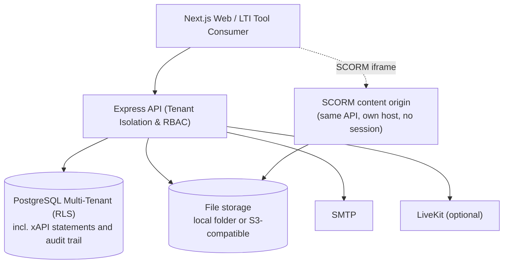

# Enterprise Educational Learning Management System (LMS)

> Multi-tenant LMS for universities and training organisations: courses, quizzes, assignments, gradebook,
> live classes, SCORM 1.2/2004, LTI 1.3 launch, xAPI learning records, SSO/SCIM, and privacy tooling for FERPA and
> GDPR requests.

---

## Architecture Overview



Not built yet (see [docs/ROADMAP.md](docs/ROADMAP.md)): API gateway/WAF, Redis as a cache and job queue (it is only
used for shared rate limits today), a dedicated LRS (xAPI is stored in PostgreSQL today),
mobile apps.
Compliance (FERPA, SOC 2, WCAG) is **not** claimed by the software; `GET /api/v1/admin/compliance` reports measured facts only.

---

## Monorepo Structure

```text
LMS/
├── apps/
│   ├── api/                 # Express backend with tenant, session and security middleware
│   └── web/                 # Next.js Enterprise Student & Instructor Portal
├── packages/
│   ├── database/            # Multi-Tenant Prisma Schema & PostgreSQL RLS Policies
│   └── security/            # AES-256-GCM Field-Level Encryption & RBAC/ABAC engine
├── docs/
│   └── architecture/        # In-depth architectural, compliance, and multi-tenancy guides
├── package.json             # Monorepo Workspace Configuration
└── tsconfig.json            # Root TypeScript Paths & Config
```

---

## What it does

1. **Multi-tenancy and white-labelling**
   - Tenants are resolved by custom domain (`learn.university.edu`) or subdomain.
   - Isolation is enforced in the database by PostgreSQL row-level security, as well as in queries.
2. **Teaching and learning**
   - Courses, modules and lessons, grouped by academic **terms**; a course can be **copied** into a new term with its
     material (lessons, quizzes, assignments, rubrics, grade setup, question bank) and its dates moved.
   - Optional **publishing review**: an organisation can require an administrator to approve courses before they go live.
   - Quizzes with timing, availability windows, attempts, auto-grading, manual grading and attempt review; assignments
     with rubrics, late-work rules, per-learner extensions, **submission history**, grade appeals and
     plagiarism-provider callbacks.
   - A weighted gradebook with a curve, two-person grade approval, a **grade grid** of every learner and item, and
     **CSV export**. Courses **complete automatically** when every lesson is done and, for graded courses, the
     approved grade passes.
   - **File uploads** (assignment files, lesson videos and documents) to a local folder or any S3-compatible service,
     **scanned for viruses** with ClamAV before they are stored.
   - A **course home** for learners (syllabus, upcoming work, "Continue: next lesson"), announcements, live classes on
     LiveKit, forums with moderation, a calendar that shows quiz and assignment due dates (with iCal export),
     notifications by e-mail.
3. **Interoperability**
   - **SCORM 1.2 and 2004**: packages are uploaded, unpacked and played on a separate content origin; progress and
     scores are saved, and completion finishes the lesson.
   - **LTI 1.3** resource-link launch (signature-verified). Assignment and Grade Services, Names and Roles and Deep
     Linking are not implemented yet.
   - **xAPI** statements are stored and queryable in PostgreSQL.
   - **SCIM 2.0** user provisioning, **OIDC** and **SAML 2.0** single sign-on.
4. **Security and privacy**
   - Append-only audit trail enforced by the database, MFA (TOTP), server-side session revocation.
   - Self-serve personal-data export, directory opt-out and erasure for FERPA and GDPR requests.
   - Quiz proctoring records browser events (tab switches, leaving full screen, copy and paste) and, per quiz, what
     the **camera and microphone** pick up (face out of view, more than one face, sustained sound, a device turned
     off). Detection runs in the learner's browser (MediaPipe face detector, served by the web app): only events
     are sent, never images or sound. It does not decide anything on its own: staff review the events.
5. **AI assistance (optional)**
   - A study tutor for learners, grounded in the course's lessons, and draft course outlines for instructors.
   - Each organisation's administrators choose the provider (Claude, Gemini or Grok), the model and the API key under
     Administration › Plan & Integrations; the key is stored encrypted and never shown again. A platform-wide default
     can be set with `AI_PROVIDER` / `AI_API_KEY`. Without a key the AI features are hidden.

---

## Getting Started

### 1. Install dependencies
```bash
npm install
```

### 2. Configure environment
```bash
cp .env.example .env
```
Replace every `CHANGE_ME` value. The API **refuses to start** with missing, short, placeholder, or publicly known secrets.

```bash
node -e "console.log('JWT_SECRET=' + require('crypto').randomBytes(48).toString('base64url'))"
node -e "console.log('PII_ENCRYPTION_KEY=' + require('crypto').randomBytes(32).toString('hex'))"
```

### 3. Database
Needs PostgreSQL. Use two roles: an unprivileged `lms_app` for the API and a privileged one for migrations (see [multi-tenancy](docs/architecture/multi_tenancy.md#3-database-roles-important)).
```bash
psql -f packages/database/sql/create_app_role.sql        # once, as a superuser
npm run db:deploy -w @enterprise-lms/database           # migrations (uses DIRECT_URL)
npm run db:seed   -w @enterprise-lms/database           # dev only; users get SEED_PASSWORD
```
The `db:*` scripts load the root `.env` for you.

### 4. Run
```bash
npm run dev   # API on :4000, web on :3000
```

### 5. Test
```bash
npm test                                  # API, database and security packages
(cd apps/web && npx tsc --noEmit -p .)    # the root typecheck does not cover the web app
```

### File storage and SCORM

| Setting | What it does |
|---|---|
| `STORAGE_DRIVER=local` (default), `STORAGE_LOCAL_DIR` | Uploads go to a folder on the API server (one server only; back it up). docker-compose keeps it in the `uploads` volume. |
| `STORAGE_DRIVER=s3`, `S3_BUCKET`, `S3_REGION`, `S3_ENDPOINT`, `S3_ACCESS_KEY_ID`, `S3_SECRET_ACCESS_KEY`, `S3_FORCE_PATH_STYLE` | Any S3-compatible service (AWS S3, Cloudflare R2, MinIO, Backblaze B2). Downloads redirect to five-minute signed links. |
| `UPLOAD_MAX_MB` (default 100) | Largest upload. The web proxy limit in `apps/web/next.config.ts` must be at least this. |
| `CLAMAV_URL` (e.g. `tcp://clamav:3310`), `CLAMAV_TIMEOUT_MS`, `FILE_SCAN_SWEEP_INTERVAL_SECONDS` | Scan every upload with a ClamAV daemon before it is stored. Infected files are refused (422, audited); while the scanner cannot answer, uploads are refused (503). Files stored before it was set are scanned in the background, and any found infected are no longer served (410). Unset: uploads are stored unscanned, with a warning at startup in production. docker-compose: `CLAMAV_URL=tcp://clamav:3310 docker compose --profile scan up`. |
| `SCORM_CONTENT_ORIGIN` | Where SCORM packages are served: a host name of its own pointing at the API (e.g. `https://content.example.org`), never the web app's origin, and not sharing a cookie domain with it. Without it SCORM is off in production; development uses `http://127.0.0.1:4000`. |

Uploads are refused when their type could run script in a browser (HTML, SVG) and are always served with `nosniff`.
SCORM packages run their own scripts, which is why they live on their own origin: there is no session there, every
link carries a signed token for one learner and one package, the host answers nothing but `/scorm-content`, and only
the LMS may frame it.

---

## API description (OpenAPI)

The API describes itself: `GET /api/v1/openapi.json` (committed copy: `apps/api/openapi.json`). It is generated from the routes the server actually mounts, so every route is listed with its authentication and required roles; every route has a summary and, where the handler validates a body or query, its request schema (generated once into `apps/api/src/openapi/docs-auto.ts`); response schemas are hand-written (`docs.ts` and `responses/*.ts`) and verified against real responses by the contract tests. `npm run api:sync` regenerates everything; a test fails when a route has no described response. Request schemas are the same Zod schemas the handlers validate with.

- After changing routes or schemas: `npm run api:sync` (rewrites `apps/api/openapi.json` and the web's generated `apps/web/src/lib/api-schema.ts`). A test fails if either is stale.
- The web app calls documented endpoints through `typedGet()` (`apps/web/src/lib/typed-api.ts`): a changed response shape or query parameter is a compile error.
- `apps/api/test/openapi.test.ts` also proves that every route not on an explicit allow-list answers 401 without a session.

---

## Authentication model

- Sessions are stateless JWTs that are **re-checked against the database on every request**: a suspended or deleted user, a changed role, a password reset, a status change or a logout take effect immediately (`User.tokenVersion`; a per-process cache of 10 s applies across instances). Logout signs the user out everywhere.
- `GET /health` is liveness; `GET /ready` checks the database. All of `/api/v1` has a per-IP rate limit (`API_RATE_LIMIT_MAX`, `API_WRITE_RATE_LIMIT_MAX`); set `REDIS_URL` to share the counters between API instances; without it they are per process.
- Failed webhook deliveries are retried with backoff by a background sweeper (`WEBHOOK_RETRY_INTERVAL_SECONDS`); the tenant export and forum replies are paged/streamed so large tenants do not load everything into memory.
- Passwords are hashed with bcrypt. Legacy SHA-256 / scrypt hashes are upgraded on next successful sign-in; plaintext is never accepted.
- `POST /api/v1/auth/login` sets the session as an **httpOnly, SameSite=Lax** cookie (`Secure` in production). No token is returned to JavaScript. API clients may also send `Authorization: Bearer <jwt>`.
- The web app proxies `/api/v1/*` to the API (`API_URL`), so the cookie is first-party. `src/middleware.ts` validates the session with the API before serving `/student`, `/teacher` and `/admin`.
- After `MAX_FAILED_LOGINS` failures an account is locked for `LOCKOUT_MINUTES`. Login and token endpoints are rate limited per IP; set `TRUST_PROXY=1` when the API sits behind the Next.js proxy or a load balancer and is not directly reachable from the internet.
- The tenant of an authenticated request always comes from the verified token. `x-tenant-id` / host are only hints used to pick the tenant at login.
- Tenant isolation is enforced by PostgreSQL row-level security as well as by application queries; see [docs/architecture/multi_tenancy.md](docs/architecture/multi_tenancy.md).
- Password reset and email verification use single-use, hashed, expiring tokens. Until a real mail transport is registered with `setMailer()`, links are only printed to the console in development.
