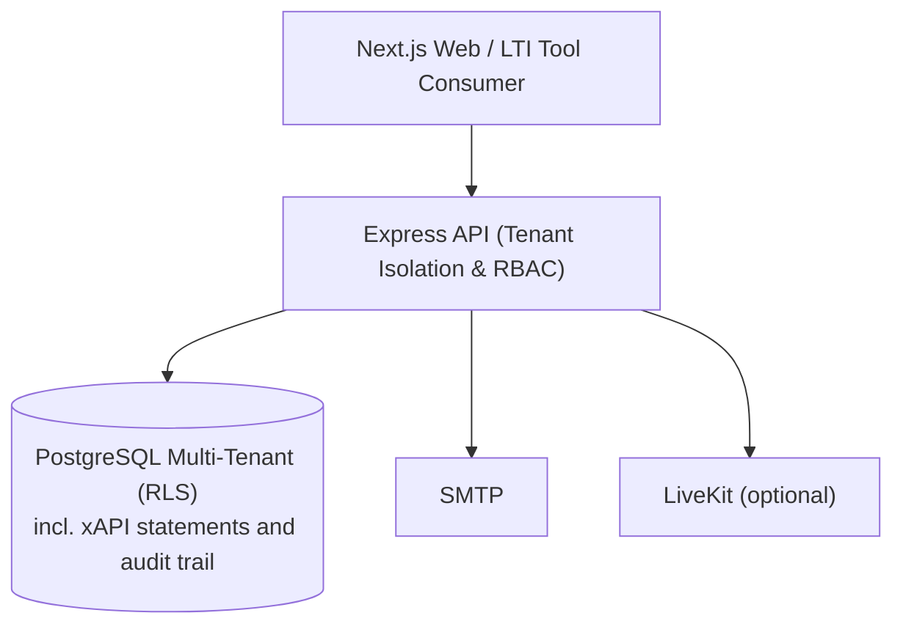

# Enterprise Educational Learning Management System (LMS)

> Enterprise-Grade, Multi-Tenant, Cloud-Native LMS with SCORM, xAPI, LTI 1.3 Advantage, AI Proctoring, and FERPA/SOC2 Compliance.

---

## Architecture Overview



Not built yet (see [docs/ROADMAP.md](docs/ROADMAP.md)): API gateway/WAF, Redis (shared rate limits, cache, job queue),
object storage for assets and SCORM packages, a dedicated LRS (xAPI is stored in PostgreSQL today), mobile apps.
Compliance (FERPA, SOC 2, WCAG) is **not** claimed by the software; `GET /api/v1/admin/compliance` reports measured facts only.

---

## Monorepo Structure

```text
LMS/
├── apps/
│   ├── api/                 # Express backend with tenant, session and security middleware
│   └── web/                 # Next.js Enterprise Student & Instructor Portal
├── packages/
│   ├── database/            # Multi-Tenant Prisma Schema & PostgreSQL RLS Policies
│   ├── standards/           # SCORM 1.2/2004, xAPI (Tin Can), & LTI 1.3 Advantage specs
│   └── security/            # AES-256-GCM Field-Level Encryption & RBAC/ABAC engine
├── docs/
│   └── architecture/        # In-depth architectural, compliance, and multi-tenancy guides
├── package.json             # Monorepo Workspace Configuration
└── tsconfig.json            # Root TypeScript Paths & Config
```

---

## Key Enterprise Highlights

1. **Multi-Tenancy & White-Labeling**:
   - Dynamic tenant resolution via custom domains (`learn.university.edu`) and subdomains.
   - Database-level isolation with PostgreSQL Row-Level Security (RLS).
2. **EdTech Interoperability Standards**:
   - **SCORM 1.2 & 2004 (3rd & 4th Editions)** runtime engines.
   - **xAPI (Tin Can API)** and Learning Record Store (LRS) event ingestion.
   - **LTI 1.3 Advantage** (Assignments & Grades, Names & Roles, Deep Linking).
3. **Security & Regulatory Compliance**:
   - **FERPA**, **COPPA**, **GDPR**, and **SOC 2 Type II** audit trails.
   - Field-Level Encryption (AES-256-GCM) for student PII.
   - AI-powered anti-cheat proctoring & telemetry logging.

---

## Getting Started

### 1. Install dependencies
```bash
npm install
```

### 2. Configure environment
```bash
cp .env.example .env
```
Replace every `CHANGE_ME` value. The API **refuses to start** with missing, short, placeholder, or publicly known secrets.

```bash
node -e "console.log('JWT_SECRET=' + require('crypto').randomBytes(48).toString('base64url'))"
node -e "console.log('PII_ENCRYPTION_KEY=' + require('crypto').randomBytes(32).toString('hex'))"
```

### 3. Database
Needs PostgreSQL. Use two roles: an unprivileged `lms_app` for the API and a privileged one for migrations (see [multi-tenancy](docs/architecture/multi_tenancy.md#3-database-roles-important)).
```bash
psql -f packages/database/sql/create_app_role.sql        # once, as a superuser
npm run db:deploy -w @enterprise-lms/database           # migrations (uses DIRECT_URL)
npm run db:seed   -w @enterprise-lms/database           # dev only; users get SEED_PASSWORD
```
The `db:*` scripts load the root `.env` for you.

### 4. Run
```bash
npm run dev   # API on :4000, web on :3000
```

### 5. Test
```bash
npm test
```

---

## API description (OpenAPI)

The API describes itself: `GET /api/v1/openapi.json` (committed copy: `apps/api/openapi.json`). It is generated from the routes the server actually mounts, so every route is listed with its authentication and required roles; request and response schemas are filled in for the documented endpoints (`apps/api/src/openapi/docs.ts`, starting with auth, courses and enrollments) and extended as endpoints are documented. Request schemas are the same Zod schemas the handlers validate with.

- After changing routes or schemas: `npm run api:sync` (rewrites `apps/api/openapi.json` and the web's generated `apps/web/src/lib/api-schema.ts`). A test fails if either is stale.
- The web app calls documented endpoints through `typedGet()` (`apps/web/src/lib/typed-api.ts`): a changed response shape or query parameter is a compile error.
- `apps/api/test/openapi.test.ts` also proves that every route not on an explicit allow-list answers 401 without a session.

---

## Authentication model

- Sessions are stateless JWTs that are **re-checked against the database on every request**: a suspended or deleted user, a changed role, a password reset, a status change or a logout take effect immediately (`User.tokenVersion`; a per-process cache of 10 s applies across instances). Logout signs the user out everywhere.
- `GET /health` is liveness; `GET /ready` checks the database. All of `/api/v1` has a per-IP rate limit (`API_RATE_LIMIT_MAX`, `API_WRITE_RATE_LIMIT_MAX`); set `REDIS_URL` to share the counters between API instances; without it they are per process.
- Failed webhook deliveries are retried with backoff by a background sweeper (`WEBHOOK_RETRY_INTERVAL_SECONDS`); the tenant export and forum replies are paged/streamed so large tenants do not load everything into memory.
- Passwords are hashed with bcrypt. Legacy SHA-256 / scrypt hashes are upgraded on next successful sign-in; plaintext is never accepted.
- `POST /api/v1/auth/login` sets the session as an **httpOnly, SameSite=Lax** cookie (`Secure` in production). No token is returned to JavaScript. API clients may also send `Authorization: Bearer <jwt>`.
- The web app proxies `/api/v1/*` to the API (`API_URL`), so the cookie is first-party. `src/middleware.ts` validates the session with the API before serving `/student`, `/teacher` and `/admin`.
- After `MAX_FAILED_LOGINS` failures an account is locked for `LOCKOUT_MINUTES`. Login and token endpoints are rate limited per IP; set `TRUST_PROXY=1` when the API sits behind the Next.js proxy or a load balancer and is not directly reachable from the internet.
- The tenant of an authenticated request always comes from the verified token. `x-tenant-id` / host are only hints used to pick the tenant at login.
- Tenant isolation is enforced by PostgreSQL row-level security as well as by application queries; see [docs/architecture/multi_tenancy.md](docs/architecture/multi_tenancy.md).
- Password reset and email verification use single-use, hashed, expiring tokens. Until a real mail transport is registered with `setMailer()`, links are only printed to the console in development.
