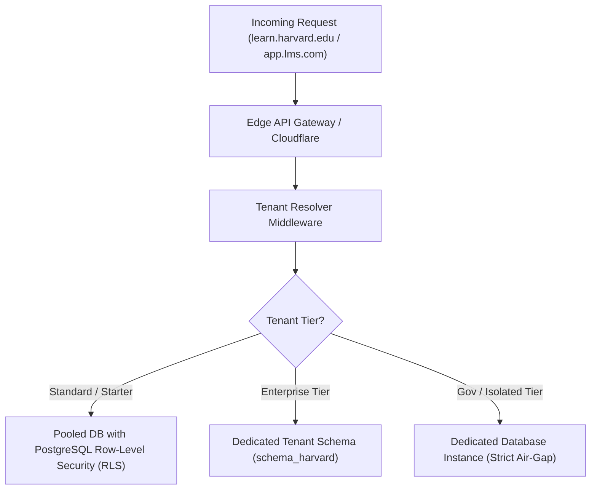

# Multi-Tenancy Architecture Guide

## Overview
The Enterprise LMS is designed around a hybrid multi-tenant model supporting three operational tiers:



## 1. Tenant Resolution Flow
1. **Custom Domain / Subdomain Extraction**: 
   - Host `stanford.lms.domain.com` $\rightarrow$ resolves `slug: stanford`
   - Custom Apex `learn.mit.edu` $\rightarrow$ resolves `customDomain: learn.mit.edu`
2. **Context Injection**: 
   - Express/NestJS middleware extracts tenant credentials and injects `req.tenantId`.
3. **Database Session Initialization**:
   - For PostgreSQL pooled queries:
     ```sql
     SET LOCAL app.current_tenant_id = 'tenant-uuid';
     ```
   - Row-Level Security (RLS) automatically prevents any leakage between tenants.

## 2. White-Labeling & Customization
- Dynamic CSS token injection (Primary brand color, secondary color, typography).
- Custom email templates with tenant-specific DKIM/SPF domain verification.
- Isolated storage buckets: `s3://lms-assets-{tenantId}/` for media and SCORM packages.
