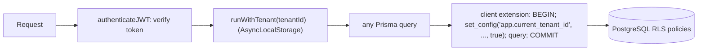

# Multi-Tenancy Architecture Guide

The LMS uses a **pooled** model: all tenants share one PostgreSQL database and schema, and every
tenant-owned row is isolated by **PostgreSQL Row-Level Security (RLS)** in addition to the
application's own `tenantId` filters. Dedicated-schema and dedicated-database tiers are not
implemented.

## 1. Where the tenant comes from

| Request                                     | Tenant source                                                                     |
| ------------------------------------------- | --------------------------------------------------------------------------------- |
| Authenticated                               | The `tenantId` claim of the verified JWT. **Never** a header, host or body field. |
| Login, password reset, `GET /tenant/config` | A _hint_, resolved to a tenant row in the database.                               |

Hints are tried in order and may each be a tenant id, slug or custom domain:

1. `x-tenant-id` header
2. the request host (matches `Tenant.customDomain`, e.g. `learn.university.edu`; only verified domains are stored there, see [custom domains](../custom-domains.md))
3. the first host label (matches `Tenant.slug`, e.g. `stanford` from `stanford.lms.example.com`)
4. `DEFAULT_TENANT_SLUG`

`X-Forwarded-Host` replaces the host only when `TRUST_PROXY` > 0. Suspended and archived tenants
never resolve. After resolution only the tenant `id` is used.

Hints affect _which tenant a user signs in to_, nothing else: the password must still match that
tenant's account. Emails are unique per tenant, so the same address can exist in several tenants.

## 2. How isolation is enforced



- `packages/database/src/index.ts` exposes `runWithTenant()`, a Prisma client extension that wraps
  every query in a transaction that first sets `app.current_tenant_id` (transaction-local, so it
  cannot leak across pooled connections), and `runInTenantTransaction()` for multi-statement work.
- Migration `*_row_level_security` enables **and forces** RLS:
  - tables with a `tenantId` column: `User`, `Campus`, `Course`, `Enrollment`, `Quiz`,
    `Assignment`, `AuditLog`, `LtiDeployment`;
  - child tables (`Department`, `CourseInstructor`, `Module`, `Lesson`, `Certificate`,
    `QuizQuestion`, `QuizSubmission`, `ProctoringLog`, `AssignmentSubmission`, `UserGuardian`):
    visible only if their parent is, so isolation chains down to the tenant root.
- **Fail closed:** with no tenant set, tenant tables return no rows and reject writes.
- `WITH CHECK` means a tenant cannot insert rows for another tenant or attach children to another
  tenant's parent.

Deliberately outside RLS: `Tenant` (must be readable to resolve a tenant at login) and the
`PasswordResetToken` / `EmailVerificationToken` tables (looked up by the SHA-256 of a 256-bit
secret; each row stores its `tenantId`).

Known gap: foreign keys are not tenant-aware, so the database alone does not stop an `Enrollment`
row of tenant A from referencing a course of tenant B. Routes validate this (they look the course up
inside the tenant first); composite foreign keys are a possible hardening.

## 3. Database roles (important)

RLS is **silently skipped** for superusers and roles with `BYPASSRLS`. Use two roles:

| Role              | Used for                    | Setting                                                        |
| ----------------- | --------------------------- | -------------------------------------------------------------- |
| `lms_app`         | the running API             | `DATABASE_URL`; `NOSUPERUSER NOBYPASSRLS`, not the table owner |
| a privileged role | migrations and the dev seed | `DIRECT_URL`                                                   |

At startup the API checks the role it connected with. In production it exits if RLS would be
bypassed; in development it logs a warning.

## 4. Setting up a database

```bash
# 1. as a superuser, once (edit the password first)
psql -f packages/database/sql/create_app_role.sql

# 2. apply migrations with the privileged role
npm run db:deploy -w @enterprise-lms/database

# 3. dev only: demo data
npm run db:seed -w @enterprise-lms/database
```

Create `lms_app` **before** `db:deploy` so the migration can grant it privileges.

### Existing database created with `prisma db push`

It has no migration history and lacks the new columns (`Quiz.tenantId`, `Assignment.tenantId`,
the token tables). For a disposable dev database, drop and recreate it, then run the steps above
(`prisma migrate reset` also does this and **erases all data**). If it holds data you need, back it
up, apply the schema differences by hand, then mark the baseline as applied with
`prisma migrate resolve --applied 20261012000000_init` and deploy the RLS migration.

## 5. Tests

`npm test` runs the isolation suite against a **throwaway** PostgreSQL (the `embedded-postgres`
package, random port, temp data directory). It applies the real migrations, connects as the real
unprivileged role and verifies, among other things, that a tenant cannot read, update, delete or
insert across tenants, that concurrent requests do not leak, and that the full API respects
tenancy. It never connects to any database you have configured.

## 6. White-labeling

Branding is stored on `Tenant` (`logoUrl`, `primaryColor`, `secondaryColor`, `faviconUrl`,
`customCss`) and served by `GET /api/v1/tenant/config`. Custom email templates, DKIM/SPF, and
per-tenant storage buckets are not implemented.
